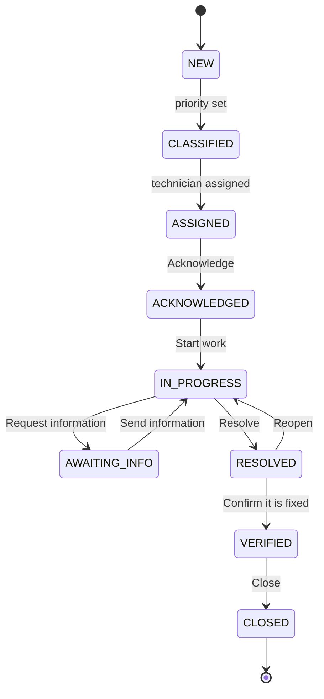
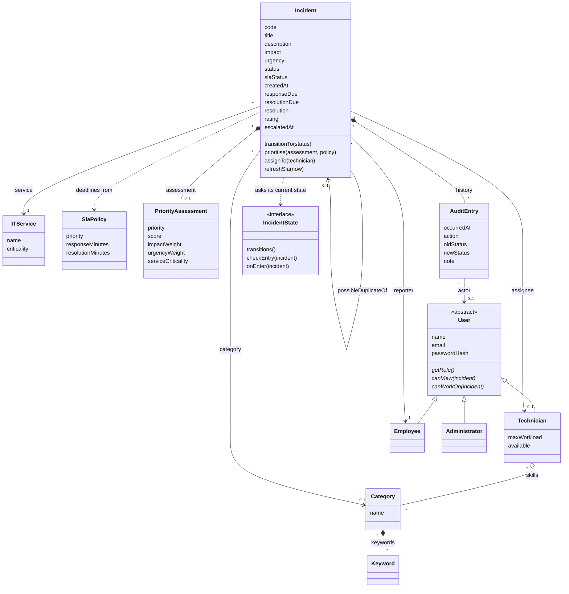

# I-ITSM

Intelligent IT Service Management & Incident Resolution System, built for the CS F213 / MAC F212 OOP project. The project brief is in [`docs/brief.pdf`](docs/brief.pdf).

**What it does:**

- Sign-in with three roles, one home screen and navbar per role, every URL checked on the server.
- Employees report incidents and follow them. Each incident gets a code (`INC-0001`, …).
- The priority is calculated from impact, urgency and service criticality, and the SLA deadlines are set from it.
- A technician is assigned automatically by one of three strategies. An administrator can switch strategy while the app runs, and can reassign by hand.
- Incidents move through a fixed lifecycle. Each role sees only the buttons it may use. Technicians add investigation notes, ask for information and record the resolution; employees answer, confirm or reopen, and rate the resolution.
- A background job checks every open incident against its SLA once a minute: at risk at 75%, breached past the deadline, paused while waiting for information.
- People are notified in the app (the bell) and by simulated email.
- Four intelligent features, each explaining itself on screen: duplicate detection, automatic escalation, category suggestion and an SLA risk list.
- Search with eight filters, an administrator dashboard, and pages to manage services, categories, technicians and SLA policies.
- Every change is recorded in an audit trail, shown as a timeline on the incident page.

## Run it

You need **JDK 25**. Check with `java -version`. Maven is not needed: the `mvnw` script downloads it on first use.

```bash
./mvnw spring-boot:run
```

On Windows use `mvnw.cmd spring-boot:run`.

Then open <http://localhost:8080>. The first start creates the database in `./data` and fills it with the demo data below.

> **Coming from an earlier version?** A database made by the first version (before incident reporting existed) must be deleted once: stop the app and delete the `data` folder. Databases made by later versions are upgraded in place when the app starts.

## Demo logins

| Role          | Email              | Password     | Lands on                |
|---------------|--------------------|--------------|-------------------------|
| Administrator | `admin@itsm.local` | `admin12345` | `/admin/dashboard`      |
| Technician    | `tech1@itsm.local` | `tech12345`  | `/technician/dashboard` |
| Technician    | `tech2@itsm.local` | `tech12345`  | `/technician/dashboard` |
| Technician    | `tech3@itsm.local` | `tech12345`  | `/technician/dashboard` |
| Technician    | `tech4@itsm.local` | `tech12345`  | `/technician/dashboard` |
| Employee      | `emp1@itsm.local`  | `emp12345`   | `/employee/dashboard`   |
| Employee      | `emp2@itsm.local`  | `emp12345`   | `/employee/dashboard`   |
| Employee      | `emp3@itsm.local`  | `emp12345`   | `/employee/dashboard`   |
| Employee      | `emp4@itsm.local`  | `emp12345`   | `/employee/dashboard`   |

New employees can sign themselves up at `/register`. Technicians and administrators cannot be created that way.

The four technicians have different skills:

| Technician  | Login   | Skills                            | Max workload |
|-------------|---------|-----------------------------------|--------------|
| Ravi Kumar  | `tech1` | Network, Hardware                 | 5            |
| Meera Nair  | `tech2` | Database, Storage, Cloud          | 4            |
| Arjun Singh | `tech3` | Security, Authentication, Network | 3            |
| Sara Thomas | `tech4` | Software, Application, Cloud      | 5            |

The seed data also has 6 IT services (criticality 1 to 3), the brief's 9 incident categories with keywords, and the brief's SLA policies:

| Priority      | Respond within | Resolve within |
|---------------|----------------|----------------|
| P1 · Critical | 5 min          | 30 min         |
| P2 · High     | 15 min         | 2 h            |
| P3 · Medium   | 1 h            | 8 h            |
| P4 · Low      | 4 h            | 24 h           |

## Demo scripts

Use separate browser windows that do not share a login (a normal window, a private window, another browser), one per person, so everyone stays signed in. All passwords are in the table above. Start from a fresh database (delete the `data` folder) if you want the same incident codes as below.

### Workflow 1: employee reports → system prioritises → technician assigned → notification generated

1. Sign in as `emp1@itsm.local`. Click **Report an incident**.
2. Enter title `Payment application unavailable` and description `Users are unable to complete transactions.` Choose service **Payment Application**. Leave **Category** on *Let the system choose*. Choose impact **High** and urgency **High**. Click **Report incident**.
3. You are on the page of `INC-0001`. Point out:
   - Category **Application**, with the line "chosen automatically because the report mentions: application, payment, unavailable".
   - Priority **P1 · Critical**, and the box "How the priority was worked out": 3 × 3 × 3 = 27.
   - "Respond by" 5 minutes and "Resolve by" 30 minutes after "Reported"; SLA badge **On track**.
   - Status **Assigned**, assigned to **Sara Thomas** (the only technician with the Application skill).
   - The timeline: reported, category chosen, priority calculated, technician assigned.
4. In a second window sign in as `tech4@itsm.local`. The bell shows **1**. Click it: "INC-0001 has been assigned to you".
5. In a third window sign in as `admin@itsm.local`. Click **Email outbox**: the same news as simulated emails to the reporter and the technician.

### Workflow 2: technician investigates → SLA monitored → incident resolved → user notified

Continue from workflow 1.

1. As the technician, click the notification (or **My queue** → `INC-0001`). Click **Acknowledge**, then **Start work**.
2. In "Add an investigation note" type `The gateway log shows TLS errors.` and click **Add to the timeline**.
3. In the "Change status" box type `Does it fail for every customer?` and click **Request information**. The SLA badge turns **Paused**: the resolution clock stops while the technician waits.
4. As the employee, open **Dashboard**. The card **Waiting for you** lists the incident. Open it, type an answer and click **Send information**. The SLA badge is **On track** again and "Resolve by" has moved back by the time spent waiting.
5. As the technician, reload. Type what you did, for example `Renewed the expired certificate.`, and click **Resolve**. The SLA badge turns **Met**.
6. As the employee, the bell has a new notification: "INC-0001 has been resolved". Click it. The page shows the **Resolution**. Click **Confirm it is fixed** (or type why not and click **Not fixed, reopen**).
7. A box **Rate the resolution** appears. Choose **5**, add a comment, click **Send rating**.
8. As the administrator, open **Incidents** → `INC-0001` and click **Close**. The timeline shows the whole story.

### Workflow 3: several incidents reported → duplicates identified → escalated

1. As the administrator, open **Settings** and click **Switch demo SLA on** (P1: respond within 1 minute).
2. As `emp1@itsm.local`, report `Payment application unavailable` against **Payment Application**, impact and urgency **High**.
3. As `emp2@itsm.local` (another window), report `Payment transaction failing` against the same service. Its page shows a yellow box: "Possible duplicate of INC-0002 (similarity 0.50, same service, less than a minute apart)".
4. As `emp3@itsm.local`, report `Unable to make payment` against the same service. Its page shows "Possible duplicate of INC-0002 (similarity 1.00, …)".
5. As `emp1@itsm.local` again, try to report `Payment application unavailable` a second time. The form refuses: "You have already reported this: INC-0002 is still open."
6. As the administrator, open **Incidents**: the two later ones carry a **possible duplicate** badge. Open the first one: "Later incidents that look like duplicates of this one" links to both.
7. Open **Dashboard**. The list **Most likely to breach next** shows the three incidents with the reason, for example "Response due in 40 s · 33% of the time used · not acknowledged yet".
8. Do not acknowledge anything. Wait until a minute has passed since the first report, then open **Settings** and click **Run the SLA check now** (or wait up to a minute more for the background job).
9. Open **Dashboard**: SLA breaches has gone up and a black card says "3 escalated incidents need your attention". The bell shows the escalation notifications. Open an incident: badges **Breached** and **Escalated**, and the reason in a grey box and in the timeline.
10. Switch demo SLA off again on the **Settings** page.

### Show an SLA breach in under two minutes

1. As the administrator: **Settings** → **Switch demo SLA on**.
2. As an employee: report any incident with impact **High** and urgency **High** against **Payment Application**. Note the time.
3. Do nothing for one minute. (After about 45 seconds the SLA badge turns **At risk** once the check has run.)
4. As the administrator: **Settings** → **Run the SLA check now**.
5. Open the incident: SLA badge **Breached**, "Respond by … **missed**", and "SLA breached" in the timeline. The administrator's bell has the notification.

Without the button, the background job finds the breach by itself within one more minute.

Other things worth showing:

- **Nobody can take it.** Report four incidents with category **Security** (give each its own title). Only Arjun has that skill and his maximum is 3, so the fourth stays **Classified**; the administrator sees a warning and assigns it by hand.
- **Switch strategy.** **Settings** → choose **Least loaded** or **Round robin** → **Use this strategy**. The next incident is assigned differently.
- **Refused actions.** An employee who opens another employee's incident gets the 403 page with the reason.

## How it works

### Priority

`PriorityCalculator` is an interface; `WeightedPriorityCalculator` is the implementation in use.

> Score = impact × urgency × service criticality, each from 1 to 3.

| Score   | Priority      |
|---------|---------------|
| 18 – 27 | P1 · Critical |
| 9 – 17  | P2 · High     |
| 4 – 8   | P3 · Medium   |
| 1 – 3   | P4 · Low      |

The result (the priority, the score and the three numbers) is stored with the incident, so the incident page always shows the calculation that was really made. The SLA policy for that priority then sets the two deadlines, counted from the time the incident was reported.

### Lifecycle



| From          | To            | Who                                | Button                                | Note needed |
|---------------|---------------|------------------------------------|---------------------------------------|-------------|
| NEW           | CLASSIFIED    | the system, when the priority is set | –                                   | –           |
| CLASSIFIED    | ASSIGNED      | the system, when a technician is assigned | –                              | –           |
| ASSIGNED      | ACKNOWLEDGED  | the assigned technician            | Acknowledge                           | no          |
| ACKNOWLEDGED  | IN_PROGRESS   | the assigned technician            | Start work                            | no          |
| IN_PROGRESS   | AWAITING_INFO | the assigned technician            | Request information                   | yes         |
| AWAITING_INFO | IN_PROGRESS   | the reporter, or the technician    | Send information / Resume work        | yes         |
| IN_PROGRESS   | RESOLVED      | the assigned technician            | Resolve                               | yes         |
| RESOLVED      | VERIFIED      | the reporter                       | Confirm it is fixed                   | no          |
| RESOLVED      | IN_PROGRESS   | the reporter, or an administrator  | Not fixed, reopen / Reopen            | yes         |
| VERIFIED      | CLOSED        | the technician, or an administrator | Close                                | no          |

Any other move throws `InvalidStateTransitionException` and changes nothing. `incident.transitionTo()` is the only way the status changes: there is no `setStatus`.

There is one class per status in `com.itsm.domain.state` (`NewState`, `ClassifiedState`, …), each implementing `IncidentState`. A state class says which moves are allowed from it and who may make them, what must be true before an incident can enter it (for example, ASSIGNED needs a technician), and what happens on entry (for example, RESOLVED records the resolution time).

### Assignment

`AssignmentStrategy` is an interface with three implementations:

| Strategy     | How it chooses                                                                 |
|--------------|--------------------------------------------------------------------------------|
| Skill-based  | A technician whose skills include the incident's category; among those, the one with the fewest open incidents. This is the default. |
| Least loaded | The technician with the fewest open incidents, whatever their skills.          |
| Round robin  | The technicians in turn, one after the other.                                  |

Every strategy skips technicians who are not available or already at their maximum workload. If nobody is left, the strategy throws `TechnicianUnavailableException`; the incident stays CLASSIFIED, the failure is written to its timeline, and administrators see a warning on their dashboard and in the navbar.

The active strategy is stored in the database (table `settings`) and read each time an incident is assigned, which is why switching it on the **Settings** page takes effect at once and survives a restart.

A manual assignment by an administrator obeys the same two rules: an unavailable technician is refused with `TechnicianUnavailableException`, a full one with `WorkloadExceededException`. Reassigning an incident that already has a technician keeps its status.

### Audit trail

Every change to an incident publishes an `IncidentEvent`. `AuditTrailListener` listens and saves an `AuditEntry` with the time, the user (or "System"), the action, the old and new status and a note. Publisher and listener run in the same database transaction, so a change and its audit entry are saved together or not at all.

### SLA monitoring

Each incident has two deadlines, set from the SLA policy of its priority and counted from the time it was reported:

| Deadline   | Met when the incident becomes | Paused |
|------------|-------------------------------|--------|
| Response   | ACKNOWLEDGED                  | never  |
| Resolution | RESOLVED                      | while it is AWAITING_INFO |

`SlaMonitor` runs once a minute (`@Scheduled`) and checks every open incident. The same check also runs straight after every status change.

| SLA status | Meaning |
|------------|---------|
| On track   | The clock is running and less than 75% of the time is used. |
| At risk    | 75% or more of the time for the next deadline is used. A warning event is published once. |
| Paused     | The incident is waiting for information. When the answer arrives, the resolution deadline moves back by exactly the time spent waiting. The same happens when a resolved incident is reopened. |
| Breached   | A deadline was missed. The time the breach was noticed is recorded once, an event is published, and the status never changes back. |
| Met        | The incident was resolved and no deadline was missed. |

The arithmetic is in `SlaTarget` (how much time is used, how much is left, is it late); `Incident.refreshSla` applies it and reports what is new.

**Demo SLA:** on the **Settings** page an administrator can switch on short deadlines (P1: 1 min / 3 min, P2: 2 / 5, P3: 3 / 8, P4: 5 / 10) for incidents reported from then on, and run the check at once.

### Notifications

`NotificationChannel` is an interface with two implementations:

| Channel        | What it does |
|----------------|--------------|
| `InAppChannel` | Saves a notification row. The bell in the navbar shows the unread count; clicking a notification marks it read and opens the incident. |
| `EmailChannel` | Simulated. Saves the email in an outbox table (administrators read it under **Email outbox**) and writes it to the log. |

`NotificationChannelFactory` hands out the channels for a kind of news: the app for everything, email as well for the important ones. `NotificationListener` listens to incident events and decides who is told:

| Event | Who is told |
|-------|-------------|
| Reported | the reporter (a confirmation) |
| Assigned or reassigned | the technician, and the reporter |
| Nobody could be assigned | the administrators |
| Information requested, resolved | the reporter |
| The reporter answered, confirmed or reopened | the technician |
| Closed | the reporter and the technician |
| Any other status change, a note | the other people on the incident |
| SLA at risk, SLA breached | the technician and the administrators |
| Escalated | the administrators |
| Rated | the technician |

Messages are sent only after the incident change has been committed, and each channel sends each message in its own database transaction inside its own try/catch. So a failing channel cannot block the other one and cannot roll back the incident change.

### Intelligent features

All four are in `com.itsm.intelligence`, and each shows its reasoning on screen.

| Feature | Rule | Where it shows |
|---------|------|----------------|
| Duplicate detection (`DuplicateDetector`) | On report, the title is compared with open incidents on the same service from the last 24 hours. Common words are removed, then similarity = shared words ÷ all words (Jaccard). At 0.4 or more the incident is linked to the most similar one. | Yellow box on the incident page: "Possible duplicate of INC-0007 (similarity 0.62, same service, 6 min apart)"; a badge in lists; a timeline entry. |
| Automatic escalation (`EscalationPolicy`) | A P1 that no technician has acknowledged by its response deadline is escalated, once. | "Escalated" badge, the reason on the incident page and in the timeline, a card on the administrator's dashboard, a notification to the administrators. |
| Category suggestion (`CategorySuggester`) | If the reporter leaves the category empty, the category whose keywords appear most often in the title and description is chosen. No keyword found: the form asks the reporter to choose. | Under the category on the incident page: "chosen automatically because the report mentions: vpn, wifi"; a timeline entry. |
| SLA risk list (`SlaRiskRanker`) | Open incidents sorted by time left until their next deadline, least first. Paused incidents and deadlines already missed are left out. | "Most likely to breach next" on the administrator's dashboard, with the reason on each line. |

"Common words" are filler words, words that only say *that* something is wrong ("unable", "failing", "unavailable") and general IT words ("application", "system"). With those removed, the brief's three examples reduce to {payment}, {payment, transaction} and {payment}, which is why they match.

Separately, the very same title from the same person against the same service, while their first report is still open, is refused outright (`DuplicateIncidentException`).

### Search

Administrators (**Incidents**) and technicians (**Search**) can filter by code, status, priority, category, service, technician, date range and SLA status. Each filter is one small `Specification` in `IncidentSpecifications`; the ones that are filled in are joined with AND.

### Errors

Every error the application raises on purpose is an `ItsmException` (package `com.itsm.error`), with a message written for the user:

| Exception | When | What the user sees |
|-----------|------|--------------------|
| `InvalidStateTransitionException` | a move the lifecycle forbids | message on the incident page |
| `TechnicianUnavailableException` | nobody, or the chosen technician, can take an incident | message; for automatic assignment a warning to administrators |
| `WorkloadExceededException` | the chosen technician is at their maximum | message |
| `MissingSlaConfigurationException` | a priority has no SLA policy | message on the report form |
| `DuplicateIncidentException` | the same report twice | message on the report form |
| `InvalidInputException` | input the form checks could not catch | message |
| `UnauthorizedOperationException` | an action the user may not take | the 403 page with the reason |
| `NotFoundException`, `ServiceNotFoundException`, `IncidentNotFoundException` | the thing does not exist | the 404 page with the reason |

`ErrorHandler` (a `@ControllerAdvice`) turns these into pages and messages for every controller, and does the same for forms that fail their Bean Validation checks. In every case nothing has been changed.

## Who can open what

Every URL is checked on the server (`SecurityConfig`). Hiding a link or a button is never the only protection.

| URL                                   | Who                    |
|---------------------------------------|------------------------|
| `/login`, `/register`, CSS and icons  | everyone               |
| `/employee/**`                        | role `EMPLOYEE`        |
| `/technician/**`                      | role `TECHNICIAN`      |
| `/admin/**`, `/h2-console/**`         | role `ADMIN`           |
| anything else                         | any signed-in user     |

On top of the role, each incident is checked. An employee can open only the incidents they reported. A technician can read every incident (for search) but can act only on the ones assigned to them. An administrator can open and act on all of them. A button press is checked the same way, so sending the request by hand does not get around a missing button. `/notifications` shows each user only their own.

A signed-in user who is refused gets the 403 page. A visitor who is not signed in is sent to `/login`.

## Database

H2 in file mode. The database is the file `./data/itsm.mv.db` and survives restarts.

**H2 console (dev only):** sign in to the app as the administrator, then open <http://localhost:8080/h2-console> and connect with:

| Field     | Value                      |
|-----------|----------------------------|
| JDBC URL  | `jdbc:h2:file:./data/itsm` |
| User Name | `sa`                       |
| Password  | *(leave empty)*            |

**Reset the database:** stop the app and delete the `data` folder. The next start rebuilds it with the demo data.

Hibernate adds new tables and columns on its own at startup, but it does not change columns that already exist. Reset after a change the old tables cannot follow, such as a new kind of user or a column that changes type. Adding a value to an enum (a new status, say) does **not** need a reset: enums are stored as plain text.

## Profiles

| Profile | When                                       | Database                    | H2 console |
|---------|--------------------------------------------|-----------------------------|------------|
| `dev`   | default, used by `./mvnw spring-boot:run`  | file `./data/itsm`          | on         |
| `test`  | used by the tests                          | in memory, thrown away      | off        |
| other   | e.g. `SPRING_PROFILES_ACTIVE=prod`         | file `./data/itsm`          | off        |

## Tests

```bash
./mvnw test
```

425 tests. The files marked "plain objects" need no database and run in milliseconds; the rest start the application against a throw-away in-memory database.

| File | What it checks |
|------|----------------|
| `WeightedPriorityCalculatorTests` (plain objects) | The priority bands, including the edges (17 is P2, 18 is P1), and the score for every combination of inputs. |
| `IncidentLifecycleTests` (plain objects) | All 81 pairs of statuses: the 10 legal moves succeed, the other 71 throw and change nothing. The buttons each role gets in each status. |
| `AssignmentStrategyTests` (plain objects) | Each strategy's choice; all three skip unavailable and full technicians and throw when nobody is left. |
| `SlaTests` (plain objects) | SLA arithmetic with exact times: 75% warning, breach recorded once, pausing and the deadline moving back, reopening. |
| `NotificationDispatcherTests` (plain objects) | A failing channel does not stop the other one, whichever comes first. |
| `DuplicateDetectorTests` (plain objects) | The brief's three payment examples match each other; the service, 24-hour and "still open" rules; the explanation text. |
| `CategorySuggesterTests` (plain objects) | Suggestions for typical reports, whole-word matching, ties, no match. |
| `EscalationAndRiskTests` (plain objects) | The escalation rule and the ordering of the SLA risk list. |
| `IncidentWorkflowTests` | Reporting, automatic and manual assignment, switching strategy, the audit trail, who may do what. |
| `FullWorkflowTests` | Investigation notes, asking and answering, recording the resolution, confirming, reopening and rating. |
| `SlaMonitoringTests` | The minute job on real incidents: warning and breach each once, pause, demo SLA. |
| `NotificationTests` | Notifications from end to end with real commits: who is told what; a failing channel neither blocks the other nor undoes the incident; the bell and the outbox. |
| `IntelligenceTests` | The four intelligent features inside the running application and on its pages. |
| `IncidentSearchTests` | One search with all eight filters together, each filter alone, and the search pages. |
| `ErrorHandlingTests` | One test per kind of error: the right message or page, and nothing changed. |
| `AdminManagementTests` | Dashboard totals; managing services, categories, technicians and SLA policies; settings. |
| `IncidentWebTests` | Reporting and working on incidents through the pages. |
| `SecurityTests`, `RegistrationTests` | Sign-in, role checks on every area, self-registration. |
| `SeedDataTests`, `DomainModelTests`, `ItsmApplicationTests` | The seed data, the JPA mapping, and that the app starts. |

A score of 17 cannot actually occur (three whole numbers from 1 to 3 never multiply to 17), so that edge is tested on the banding rule itself, and the full calculation is tested with the nearest scores that can occur (12 and 18).

## Design

### Patterns

| Pattern  | Where | Why |
|----------|-------|-----|
| State    | `IncidentState` and one class per status in `domain.state` | The rules of each status live in one class. The incident has no `if`/`switch` on its status. |
| Strategy | `AssignmentStrategy` with three implementations; `PriorityCalculator` with one; `NotificationChannel` with two | The rule can be swapped, at runtime for assignment, without touching the code that uses it. |
| Observer | `IncidentEventPublisher`, `IncidentEventListener`, with `AuditTrailListener` and `NotificationListener` as the observers | Code that changes an incident does not know who reacts to the change. Notifications were added without touching that code. |
| Factory  | `IncidentFactory`; `NotificationChannelFactory` | One place knows what a valid new incident needs, including its code. One place decides which notification channels exist and which news goes where. |
| Template method | `AbstractAssignmentStrategy` | The shared rule (skip unavailable and full technicians) is written once; each strategy fills in only how it picks. |
| Repository | the interfaces in `repository` | Database access is behind interfaces. |

### Domain model



- **Inheritance:** `Employee`, `Technician` and `Administrator` are all kinds of `User`. `User` is abstract and holds what they share. Each subclass says what its role is and which incidents it may open. All three are stored in one `users` table, and the `role` column records which kind each row is (single-table inheritance).
- **Association:** an `Incident` points at the `Employee` who reported it, the `ITService` it affects, its `Category` and the `Technician` it is assigned to. A `Technician` points at the `Category` objects that are their skills. All of these exist on their own: deleting an incident deletes none of them.
- **Composition:** a `Category` owns its keywords. An `Incident` owns its `PriorityAssessment` (stored in the incident's own row) and its history of `AuditEntry` objects: neither means anything without the incident.
- **Polymorphism:** `canView(incident)` and `canWorkOn(incident)` are answered differently by `Employee`, `Technician` and `Administrator`; the code that asks never checks which kind of user it has. The same goes for the state classes, the assignment strategies and the notification channels.
- **Encapsulation:** an incident's status, priority and assignee have no setters. They change only through `transitionTo`, `prioritise` and `assignTo`, which check the rules first.

## Project layout

```
src/main/java/com/itsm
├── domain        entities, enums and SLA arithmetic (the model above)
│   └── state     the lifecycle: IncidentState, one class per status, Transition
├── priority      PriorityCalculator and WeightedPriorityCalculator
├── assignment    AssignmentStrategy, the three strategies, AssignmentService
├── sla           SlaService (policies, demo SLA, the check) and SlaMonitor (the minute job)
├── event         IncidentEvent, the publisher, the listener interface, AuditTrailListener
├── notification  NotificationChannel, the two channels, the factory, the dispatcher, NotificationListener
├── intelligence  DuplicateDetector, EscalationPolicy, CategorySuggester, SlaRiskRanker
├── search        IncidentSearchCriteria and IncidentSpecifications
├── error         ItsmException and its subclasses
├── service       IncidentService (report, change status, notes, rating), IncidentFactory, RegistrationService
├── repository    Spring Data JPA repositories, one per entity
├── security      SecurityConfig (URL rules, form login, BCrypt) and the user lookup for sign-in
├── seed          DataSeeder: fills an empty database with the demo data
└── web           controllers and form classes, ErrorHandler, GlobalModel

src/main/resources
├── application.properties        settings shared by all profiles
├── application-dev.properties    dev profile: H2 console on
├── static/css/app.css            small additions on top of Bootstrap
└── templates
    ├── fragments      layout, the navbar for each role, shared UI pieces (badges, incident table)
    ├── auth           sign-in and registration pages
    ├── employee       home screen, report form
    ├── technician     home screen, queue
    ├── admin          dashboard, settings, email outbox, management pages
    ├── incidents      incident list, search and the incident page shared by all roles
    ├── notifications  the list behind the bell
    └── error          403, 404 and "that did not work" pages
```

## Technology

| Part        | Choice                                                        |
|-------------|---------------------------------------------------------------|
| Language    | Java 25                                                       |
| Framework   | Spring Boot 4.1 (Spring MVC, Spring Security, Spring Data JPA, Validation) |
| Pages       | Thymeleaf, Bootstrap 5 and Bootstrap Icons (served from the app, so the UI works offline) |
| Database    | H2 in file mode, through Hibernate                            |
| Build       | Maven (wrapper included)                                      |
| Tests       | JUnit, Spring MockMvc, Spring Security Test                   |
