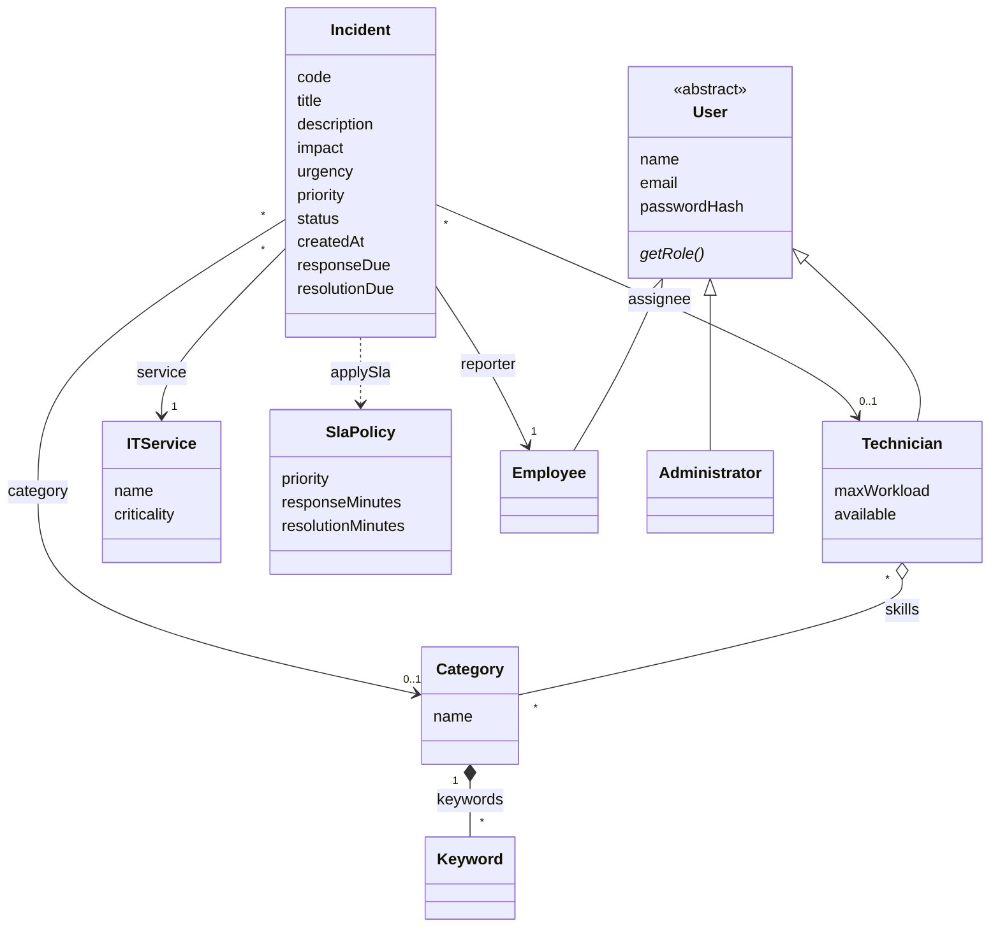

# I-ITSM

Intelligent IT Service Management & Incident Resolution System, built for the CS F213 / MAC F212 OOP project. The project brief is in [`docs/brief.pdf`](docs/brief.pdf).

**Built so far:** the project skeleton, the domain model, seed data, sign-in with three roles, one dashboard and navbar per role, and tests. Reporting and working on incidents come next.

## Run it

You need **JDK 25**. Check with `java -version`. Maven is not needed: the `mvnw` script downloads it on first use.

```bash
./mvnw spring-boot:run
```

On Windows use `mvnw.cmd spring-boot:run`.

Then open <http://localhost:8080>. The first start creates the database in `./data` and fills it with the demo data below.

## Demo logins

| Role          | Email              | Password     | Lands on                |
|---------------|--------------------|--------------|-------------------------|
| Administrator | `admin@itsm.local` | `admin12345` | `/admin/dashboard`      |
| Technician    | `tech1@itsm.local` | `tech12345`  | `/technician/dashboard` |
| Technician    | `tech2@itsm.local` | `tech12345`  | `/technician/dashboard` |
| Technician    | `tech3@itsm.local` | `tech12345`  | `/technician/dashboard` |
| Technician    | `tech4@itsm.local` | `tech12345`  | `/technician/dashboard` |
| Employee      | `emp1@itsm.local`  | `emp12345`   | `/employee/dashboard`   |
| Employee      | `emp2@itsm.local`  | `emp12345`   | `/employee/dashboard`   |
| Employee      | `emp3@itsm.local`  | `emp12345`   | `/employee/dashboard`   |
| Employee      | `emp4@itsm.local`  | `emp12345`   | `/employee/dashboard`   |

New employees can sign themselves up at `/register`. Technicians and administrators cannot be created that way.

The seed data also has 6 IT services (criticality 1 to 3), the brief's 9 incident categories with keywords, and the brief's SLA policies:

| Priority      | Respond within | Resolve within |
|---------------|----------------|----------------|
| P1 · Critical | 5 min          | 30 min         |
| P2 · High     | 15 min         | 2 h            |
| P3 · Medium   | 1 h            | 8 h            |
| P4 · Low      | 4 h            | 24 h           |

The four technicians have different skills:

| Technician  | Login   | Skills                          | Max workload |
|-------------|---------|---------------------------------|--------------|
| Ravi Kumar  | `tech1` | Network, Hardware               | 5            |
| Meera Nair  | `tech2` | Database, Storage, Cloud        | 4            |
| Arjun Singh | `tech3` | Security, Authentication, Network | 3          |
| Sara Thomas | `tech4` | Software, Application, Cloud    | 5            |

## Who can open what

Every URL is checked on the server (`SecurityConfig`). Hiding a link in the navbar is never the only protection.

| URL                                   | Who                    |
|---------------------------------------|------------------------|
| `/login`, `/register`, CSS and icons  | everyone               |
| `/employee/**`                        | role `EMPLOYEE`        |
| `/technician/**`                      | role `TECHNICIAN`      |
| `/admin/**`, `/h2-console/**`         | role `ADMIN`           |
| anything else                         | any signed-in user     |

A signed-in user who opens a page for another role gets a 403 page. A visitor who is not signed in is sent to `/login`.

## Database

H2 in file mode. The database is the file `./data/itsm.mv.db` and survives restarts.

**H2 console (dev only):** sign in to the app as the administrator, then open <http://localhost:8080/h2-console> and connect with:

| Field     | Value                      |
|-----------|----------------------------|
| JDBC URL  | `jdbc:h2:file:./data/itsm` |
| User Name | `sa`                       |
| Password  | *(leave empty)*            |

**Reset the database:** stop the app and delete the `data` folder. The next start rebuilds it with the demo data.

Do this after you change the model in a way the existing tables cannot follow, for example when you add a value to an enum such as `Status`, or add a new kind of user. Hibernate adds new tables and columns on its own, but it does not change columns that already exist.

## Profiles

| Profile | When                                       | Database                    | H2 console |
|---------|--------------------------------------------|-----------------------------|------------|
| `dev`   | default, used by `./mvnw spring-boot:run`  | file `./data/itsm`          | on         |
| `test`  | used by the tests                          | in memory, thrown away      | off        |
| other   | e.g. `SPRING_PROFILES_ACTIVE=prod`         | file `./data/itsm`          | off        |

## Tests

```bash
./mvnw test
```

43 tests, all against a throw-away in-memory database:

- `ItsmApplicationTests`: the app starts.
- `SecurityTests`: a wrong password fails; an employee cannot open `/admin`; each role is kept out of the other roles' pages; each role gets its own dashboard and navbar; logout ends the session.
- `RegistrationTests`: self-registration creates an employee with a BCrypt-hashed password; duplicate emails and invalid input are rejected.
- `SeedDataTests`: the seed data matches the lists above.
- `DomainModelTests`: incident codes (`INC-0001`, …), the JPA mapping, SLA deadlines, and the rules built into the model.
- `IncidentPagesTests`: each role sees only the incidents it should.

## Domain model



- **Inheritance:** `Employee`, `Technician` and `Administrator` are all kinds of `User`. `User` is abstract and holds what they share (name, email, password hash). Each subclass says what its role is. All three are stored in one `users` table, and the `role` column records which kind each row is (single-table inheritance).
- **Association:** an `Incident` points at the `Employee` who reported it, the `ITService` it affects, its `Category` and the `Technician` it is assigned to. A `Technician` points at the `Category` objects that are their skills. All of these exist on their own: deleting an incident deletes none of them.
- **Composition:** a `Category` owns its keywords. They are stored for that category alone (table `category_keywords`) and are deleted with it.

Other rules built into the model:

- An incident's code is built from its id when it is first saved: id 1 becomes `INC-0001`.
- `Incident.applySla(policy)` sets the priority and both deadlines together, counted from the creation time.
- Enums: `Priority` (P1 to P4), `Impact` and `Urgency` (low, medium, high, each with a weight of 1 to 3), `Status` (the brief's lifecycle: NEW, CLASSIFIED, ASSIGNED, ACKNOWLEDGED, IN_PROGRESS, RESOLVED, VERIFIED, CLOSED) and `Role`.
- Categories are database rows, not an enum, so a new category needs no code change.

## Project layout

```
src/main/java/com/itsm
├── domain       entities and enums (the model above)
├── repository   Spring Data JPA repositories, one per entity
├── security     SecurityConfig (URL rules, form login, BCrypt) and the user lookup for sign-in
├── service      business operations (employee registration)
├── seed         DataSeeder: fills an empty database with the demo data
└── web          controllers: one per role, plus sign-in and registration

src/main/resources
├── application.properties        settings shared by all profiles
├── application-dev.properties    dev profile: H2 console on
├── static/css/app.css            small additions on top of Bootstrap
└── templates
    ├── fragments   layout, the navbar for each role, shared UI pieces
    ├── auth        sign-in and registration pages
    ├── employee, technician, admin   one dashboard per role, plus the admin lists
    ├── incidents   the incident list shared by all roles
    └── error       403 and 404 pages
```

## Technology

| Part        | Choice                                                        |
|-------------|---------------------------------------------------------------|
| Language    | Java 25                                                       |
| Framework   | Spring Boot 4.1 (Spring MVC, Spring Security, Spring Data JPA, Validation) |
| Pages       | Thymeleaf, Bootstrap 5 and Bootstrap Icons (served from the app, so the UI works offline) |
| Database    | H2 in file mode, through Hibernate                            |
| Build       | Maven (wrapper included)                                      |
| Tests       | JUnit, Spring MockMvc, Spring Security Test                   |
