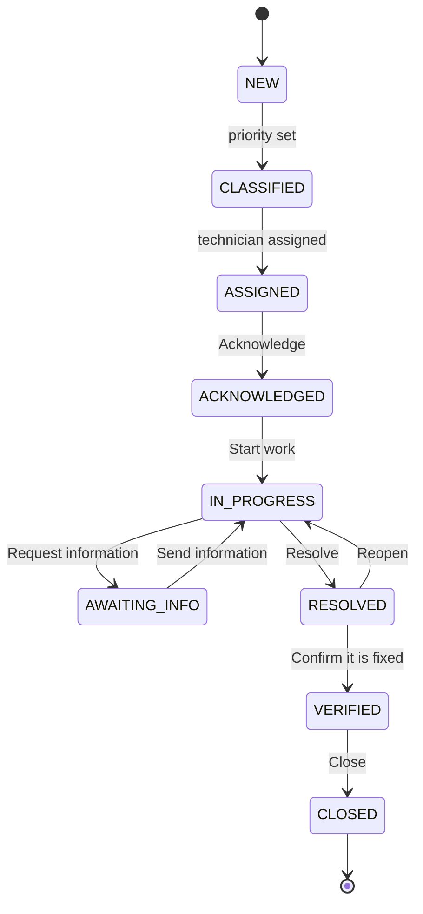
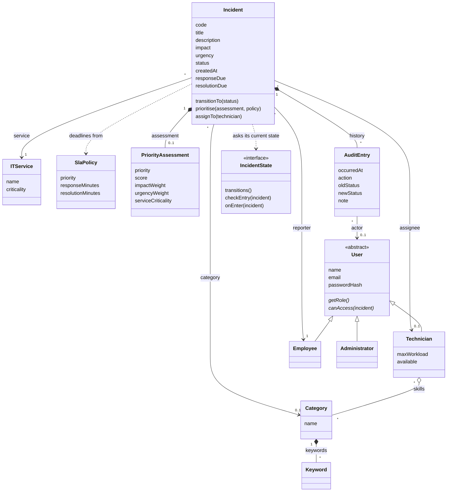

# I-ITSM

Intelligent IT Service Management & Incident Resolution System, built for the CS F213 / MAC F212 OOP project. The project brief is in [`docs/brief.pdf`](docs/brief.pdf).

**Built so far:**

- Sign-in with three roles, one dashboard and navbar per role, every URL checked on the server.
- Employees report incidents and follow them. Each incident gets a code (`INC-0001`, …).
- The priority is calculated from impact, urgency and service criticality, and the SLA deadlines are set from it.
- A technician is assigned automatically by one of three strategies. An administrator can switch strategy while the app runs, and can reassign by hand.
- Incidents move through a fixed lifecycle. Each role sees only the buttons it may use.
- Every change is recorded in an audit trail, shown as a timeline on the incident page.

Still to come: notifications, SLA monitoring and reports.

## Run it

You need **JDK 25**. Check with `java -version`. Maven is not needed: the `mvnw` script downloads it on first use.

```bash
./mvnw spring-boot:run
```

On Windows use `mvnw.cmd spring-boot:run`.

Then open <http://localhost:8080>. The first start creates the database in `./data` and fills it with the demo data below.

> **If you ran an earlier version of this project:** stop the app and delete the `data` folder once before starting. The way statuses are stored has changed, and the old database file does not know the new status `AWAITING_INFO`.

## Demo logins

| Role          | Email              | Password     | Lands on                |
|---------------|--------------------|--------------|-------------------------|
| Administrator | `admin@itsm.local` | `admin12345` | `/admin/dashboard`      |
| Technician    | `tech1@itsm.local` | `tech12345`  | `/technician/dashboard` |
| Technician    | `tech2@itsm.local` | `tech12345`  | `/technician/dashboard` |
| Technician    | `tech3@itsm.local` | `tech12345`  | `/technician/dashboard` |
| Technician    | `tech4@itsm.local` | `tech12345`  | `/technician/dashboard` |
| Employee      | `emp1@itsm.local`  | `emp12345`   | `/employee/dashboard`   |
| Employee      | `emp2@itsm.local`  | `emp12345`   | `/employee/dashboard`   |
| Employee      | `emp3@itsm.local`  | `emp12345`   | `/employee/dashboard`   |
| Employee      | `emp4@itsm.local`  | `emp12345`   | `/employee/dashboard`   |

New employees can sign themselves up at `/register`. Technicians and administrators cannot be created that way.

The four technicians have different skills:

| Technician  | Login   | Skills                            | Max workload |
|-------------|---------|-----------------------------------|--------------|
| Ravi Kumar  | `tech1` | Network, Hardware                 | 5            |
| Meera Nair  | `tech2` | Database, Storage, Cloud          | 4            |
| Arjun Singh | `tech3` | Security, Authentication, Network | 3            |
| Sara Thomas | `tech4` | Software, Application, Cloud      | 5            |

The seed data also has 6 IT services (criticality 1 to 3), the brief's 9 incident categories with keywords, and the brief's SLA policies:

| Priority      | Respond within | Resolve within |
|---------------|----------------|----------------|
| P1 · Critical | 5 min          | 30 min         |
| P2 · High     | 15 min         | 2 h            |
| P3 · Medium   | 1 h            | 8 h            |
| P4 · Low      | 4 h            | 24 h           |

## Try it: the payment outage from the brief

Use three browser windows (or one normal, one private, one other browser) so you can stay signed in as all three people.

1. **Employee reports.** Sign in as `emp1@itsm.local` / `emp12345`. Click **Report an incident**. Enter:
   - Title: `Payment application is unavailable`
   - What is happening: `Users are unable to complete transactions.`
   - Affected service: **Payment Application**
   - Category: **Application**
   - Impact: **High**, Urgency: **High**

   Click **Report incident**. You land on the page of `INC-0001`. Check:
   - Priority **P1 · Critical**. The box "How the priority was worked out" shows 3 × 3 × 3 = 27.
   - "Respond by" is 5 minutes after "Reported", "Resolve by" is 30 minutes after.
   - Status **Assigned**, assigned to **Sara Thomas** (the only technician with the Application skill).
   - The timeline has three entries: reported, priority calculated, technician assigned.
   - There is no status button: the employee has nothing to do yet.
2. **Technician works on it.** Sign in as `tech4@itsm.local` / `tech12345`. The incident is at the top of **My queue**. Open it and click **Acknowledge**, then **Start work**.
3. **Technician asks a question.** Type `Does it fail for every customer?` in the note box and click **Request information**. (Try clicking it with an empty note first: the browser refuses.)
4. **Employee answers.** In the employee window, reload the incident page. There is now a **Send information** button. Type an answer and click it.
5. **Technician resolves.** In the technician window, reload, type what you did in the note box and click **Resolve**. The technician now has no buttons left.
6. **Employee confirms.** In the employee window, reload. Click **Confirm it is fixed**. (Or type why not and click **Not fixed, reopen** to send it back to the technician.)
7. **Administrator closes.** Sign in as `admin@itsm.local` / `admin12345`. Go to **Incidents**, open `INC-0001` and click **Close**. The timeline now shows the whole story, with who did what and when.

Then try the other paths:

- **Nobody can take it.** As the employee, report four incidents with category **Security**. Only Arjun has that skill and his maximum is 3, so the fourth stays **Classified**. As the administrator, the dashboard shows a warning and the navbar a yellow badge. Open the incident and use the **Assignment** box to give it to someone by hand.
- **Switch strategy.** As the administrator, go to **Settings**, choose **Least loaded** or **Round robin** and click **Use this strategy**. Report another incident and see who gets it. No restart is needed.
- **Refused moves.** An employee who opens another employee's incident gets the 403 page. So does a technician who opens an incident that is not theirs.

## How it works

### Priority

`PriorityCalculator` is an interface; `WeightedPriorityCalculator` is the implementation in use.

> Score = impact × urgency × service criticality, each from 1 to 3.

| Score   | Priority      |
|---------|---------------|
| 18 – 27 | P1 · Critical |
| 9 – 17  | P2 · High     |
| 4 – 8   | P3 · Medium   |
| 1 – 3   | P4 · Low      |

The result (the priority, the score and the three numbers) is stored with the incident, so the incident page always shows the calculation that was really made. The SLA policy for that priority then sets the two deadlines, counted from the time the incident was reported.

### Lifecycle



| From          | To            | Who                                | Button                                | Note needed |
|---------------|---------------|------------------------------------|---------------------------------------|-------------|
| NEW           | CLASSIFIED    | the system, when the priority is set | –                                   | –           |
| CLASSIFIED    | ASSIGNED      | the system, when a technician is assigned | –                              | –           |
| ASSIGNED      | ACKNOWLEDGED  | the assigned technician            | Acknowledge                           | no          |
| ACKNOWLEDGED  | IN_PROGRESS   | the assigned technician            | Start work                            | no          |
| IN_PROGRESS   | AWAITING_INFO | the assigned technician            | Request information                   | yes         |
| AWAITING_INFO | IN_PROGRESS   | the reporter, or the technician    | Send information / Resume work        | yes         |
| IN_PROGRESS   | RESOLVED      | the assigned technician            | Resolve                               | yes         |
| RESOLVED      | VERIFIED      | the reporter                       | Confirm it is fixed                   | no          |
| RESOLVED      | IN_PROGRESS   | the reporter, or an administrator  | Not fixed, reopen / Reopen            | yes         |
| VERIFIED      | CLOSED        | the technician, or an administrator | Close                                | no          |

Any other move throws `InvalidStateTransitionException` and changes nothing. `incident.transitionTo()` is the only way the status changes: there is no `setStatus`.

There is one class per status in `com.itsm.domain.state` (`NewState`, `ClassifiedState`, …), each implementing `IncidentState`. A state class says which moves are allowed from it and who may make them, what must be true before an incident can enter it (for example, ASSIGNED needs a technician), and what happens on entry (for example, RESOLVED records the resolution time).

### Assignment

`AssignmentStrategy` is an interface with three implementations:

| Strategy     | How it chooses                                                                 |
|--------------|--------------------------------------------------------------------------------|
| Skill-based  | A technician whose skills include the incident's category; among those, the one with the fewest open incidents. This is the default. |
| Least loaded | The technician with the fewest open incidents, whatever their skills.          |
| Round robin  | The technicians in turn, one after the other.                                  |

Every strategy skips technicians who are not available or already at their maximum workload. If nobody is left, the strategy throws `TechnicianUnavailableException`; the incident stays CLASSIFIED, the failure is written to its timeline, and administrators see a warning on their dashboard and in the navbar.

The active strategy is stored in the database (table `settings`) and read each time an incident is assigned, which is why switching it on the **Settings** page takes effect at once and survives a restart.

A manual assignment by an administrator obeys the same two rules (available, below maximum). Reassigning an incident that already has a technician keeps its status.

### Audit trail

Every change to an incident publishes an `IncidentEvent`. `AuditTrailListener` listens and saves an `AuditEntry` with the time, the user (or "System"), the action, the old and new status and a note. Publisher and listener run in the same database transaction, so a change and its audit entry are saved together or not at all.

## Who can open what

Every URL is checked on the server (`SecurityConfig`). Hiding a link or a button is never the only protection.

| URL                                   | Who                    |
|---------------------------------------|------------------------|
| `/login`, `/register`, CSS and icons  | everyone               |
| `/employee/**`                        | role `EMPLOYEE`        |
| `/technician/**`                      | role `TECHNICIAN`      |
| `/admin/**`, `/h2-console/**`         | role `ADMIN`           |
| anything else                         | any signed-in user     |

On top of the role, each incident is checked: an employee can open only the incidents they reported, a technician only the incidents assigned to them, an administrator all of them. A status button press is checked the same way, so sending the request by hand does not get around a missing button.

A signed-in user who is refused gets the 403 page. A visitor who is not signed in is sent to `/login`.

## Database

H2 in file mode. The database is the file `./data/itsm.mv.db` and survives restarts.

**H2 console (dev only):** sign in to the app as the administrator, then open <http://localhost:8080/h2-console> and connect with:

| Field     | Value                      |
|-----------|----------------------------|
| JDBC URL  | `jdbc:h2:file:./data/itsm` |
| User Name | `sa`                       |
| Password  | *(leave empty)*            |

**Reset the database:** stop the app and delete the `data` folder. The next start rebuilds it with the demo data.

Hibernate adds new tables and columns on its own at startup, but it does not change columns that already exist. Reset after a change the old tables cannot follow, such as a new kind of user or a column that changes type. Adding a value to an enum (a new status, say) does **not** need a reset: enums are stored as plain text.

## Profiles

| Profile | When                                       | Database                    | H2 console |
|---------|--------------------------------------------|-----------------------------|------------|
| `dev`   | default, used by `./mvnw spring-boot:run`  | file `./data/itsm`          | on         |
| `test`  | used by the tests                          | in memory, thrown away      | off        |
| other   | e.g. `SPRING_PROFILES_ACTIVE=prod`         | file `./data/itsm`          | off        |

## Tests

```bash
./mvnw test
```

267 tests. The first three files need no database and run in milliseconds; the rest start the application against a throw-away in-memory database.

| File                              | What it checks |
|-----------------------------------|----------------|
| `WeightedPriorityCalculatorTests` | The priority bands, including the edges (17 is P2, 18 is P1), and the score for every combination of inputs. |
| `IncidentLifecycleTests`          | All 81 pairs of statuses: the 10 legal moves succeed, the other 71 throw and change nothing. Also the buttons each role gets in each status. |
| `AssignmentStrategyTests`         | Each strategy's choice, and that all three skip unavailable and full technicians and throw when nobody is left. |
| `IncidentWorkflowTests`           | Reporting, automatic and manual assignment, switching strategy, the audit trail, and who may do what, through the real services. |
| `IncidentWebTests`                | The same through the web pages, including the payment-outage scenario from report to close. |
| `SecurityTests`                   | A wrong password fails; an employee cannot open `/admin`; each role is kept out of the others' pages. |
| `RegistrationTests`               | Self-registration creates an employee with a BCrypt-hashed password. |
| `SeedDataTests`                   | The seed data matches the lists above. |
| `DomainModelTests`                | The JPA mapping and the rules built into the model. |
| `ItsmApplicationTests`            | The app starts. |

A score of 17 cannot actually occur (three whole numbers from 1 to 3 never multiply to 17), so that edge is tested on the banding rule itself, and the full calculation is tested with the nearest scores that can occur (12 and 18).

## Design

### Patterns

| Pattern  | Where | Why |
|----------|-------|-----|
| State    | `IncidentState` and one class per status in `domain.state` | The rules of each status live in one class. The incident has no `if`/`switch` on its status. |
| Strategy | `AssignmentStrategy` with three implementations; `PriorityCalculator` with one | The rule can be swapped, at runtime for assignment, without touching the code that uses it. |
| Observer | `IncidentEventPublisher`, `IncidentEventListener`, `AuditTrailListener` | Code that changes an incident does not know who reacts to the change. |
| Factory  | `IncidentFactory` | One place knows what a valid new incident needs, including its code. |
| Template method | `AbstractAssignmentStrategy` | The shared rule (skip unavailable and full technicians) is written once; each strategy fills in only how it picks. |
| Repository | the interfaces in `repository` | Database access is behind interfaces. |

### Domain model



- **Inheritance:** `Employee`, `Technician` and `Administrator` are all kinds of `User`. `User` is abstract and holds what they share. Each subclass says what its role is and which incidents it may open. All three are stored in one `users` table, and the `role` column records which kind each row is (single-table inheritance).
- **Association:** an `Incident` points at the `Employee` who reported it, the `ITService` it affects, its `Category` and the `Technician` it is assigned to. A `Technician` points at the `Category` objects that are their skills. All of these exist on their own: deleting an incident deletes none of them.
- **Composition:** a `Category` owns its keywords. An `Incident` owns its `PriorityAssessment` (stored in the incident's own row) and its history of `AuditEntry` objects: neither means anything without the incident.
- **Encapsulation:** an incident's status, priority and assignee have no setters. They change only through `transitionTo`, `prioritise` and `assignTo`, which check the rules first.

### Errors

Requests that break a rule throw a subclass of `BusinessRuleException`, whose message is written for the user and shown on the page: `InvalidStateTransitionException`, `TechnicianUnavailableException`, `MissingSlaPolicyException`. An unknown incident code gives the 404 page, and an action the user is not allowed to take gives the 403 page.

## Project layout

```
src/main/java/com/itsm
├── domain       entities and enums (the model above)
│   └── state    the lifecycle: IncidentState, one class per status, Transition
├── priority     PriorityCalculator and WeightedPriorityCalculator
├── assignment   AssignmentStrategy, the three strategies, AssignmentService
├── event        IncidentEvent, the publisher, the listener interface, AuditTrailListener
├── service      IncidentService (report, change status, assign), IncidentFactory, RegistrationService
├── repository   Spring Data JPA repositories, one per entity
├── security     SecurityConfig (URL rules, form login, BCrypt) and the user lookup for sign-in
├── seed         DataSeeder: fills an empty database with the demo data
└── web          controllers: one per role, plus sign-in and registration

src/main/resources
├── application.properties        settings shared by all profiles
├── application-dev.properties    dev profile: H2 console on
├── static/css/app.css            small additions on top of Bootstrap
└── templates
    ├── fragments   layout, the navbar for each role, shared UI pieces
    ├── auth        sign-in and registration pages
    ├── employee    dashboard, report form
    ├── technician  dashboard, queue
    ├── admin       dashboard, settings, reference data lists
    ├── incidents   the incident list and the incident page shared by all roles
    └── error       403 and 404 pages
```

## Technology

| Part        | Choice                                                        |
|-------------|---------------------------------------------------------------|
| Language    | Java 25                                                       |
| Framework   | Spring Boot 4.1 (Spring MVC, Spring Security, Spring Data JPA, Validation) |
| Pages       | Thymeleaf, Bootstrap 5 and Bootstrap Icons (served from the app, so the UI works offline) |
| Database    | H2 in file mode, through Hibernate                            |
| Build       | Maven (wrapper included)                                      |
| Tests       | JUnit, Spring MockMvc, Spring Security Test                   |
