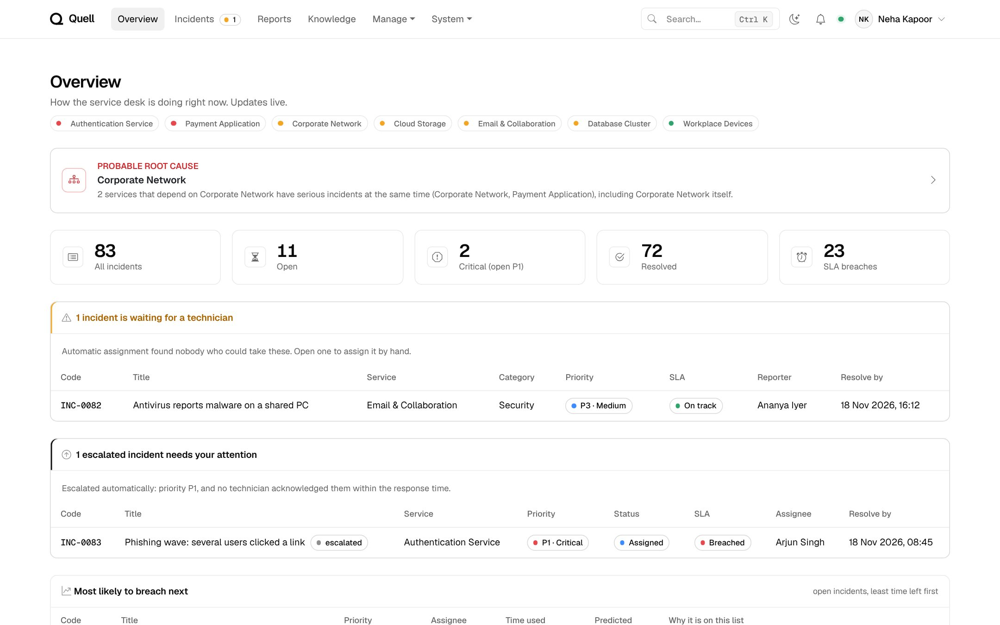
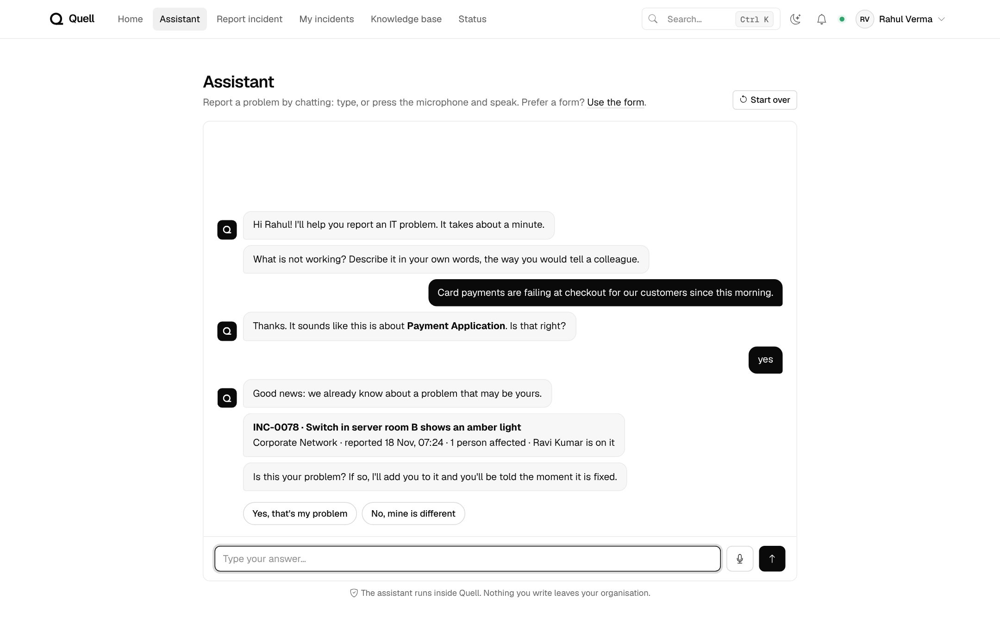
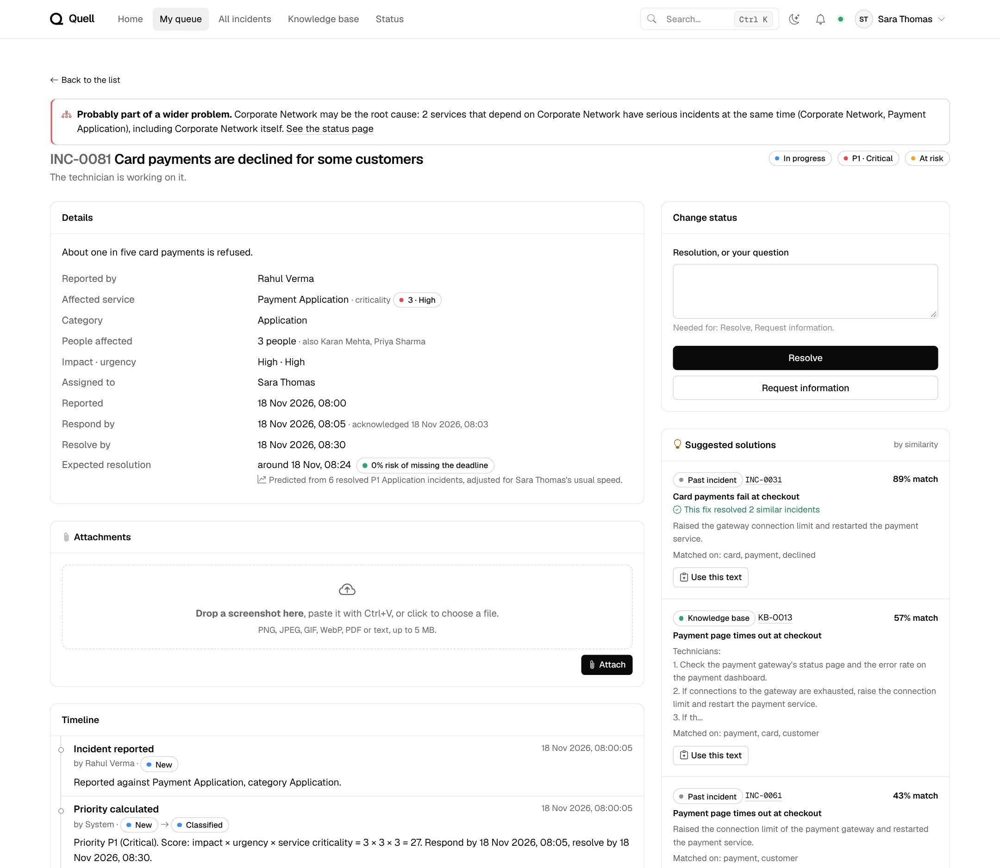
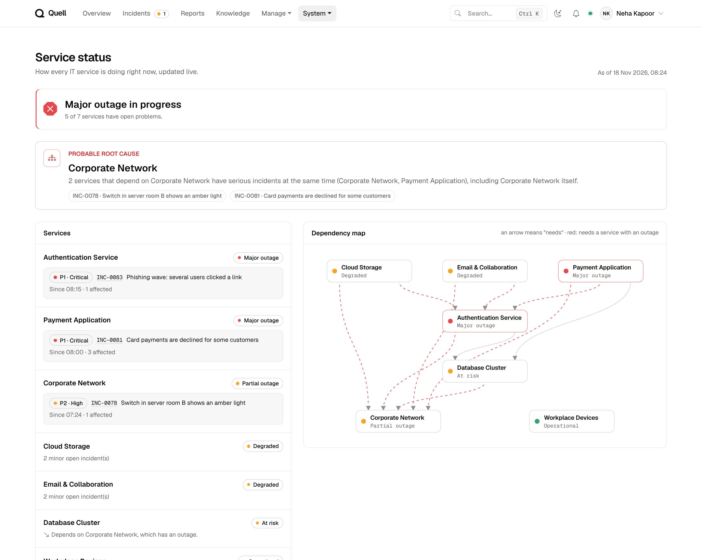
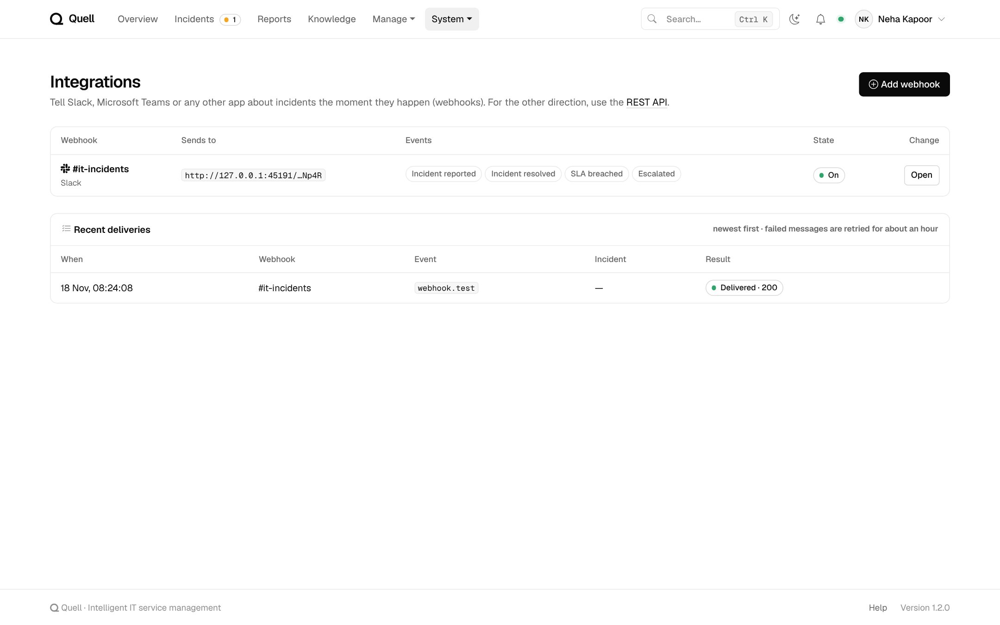

<p align="center">
  <picture>
    <source media="(prefers-color-scheme: dark)" srcset="docs/brand/quell-logo-white.svg">
    
  </picture>
</p>

<p align="center"><b>Intelligent IT service management.</b> IT incidents, resolved before they escalate.</p>

<p align="center">
  <a href="https://github.com/PresidentOfBirTawil/quell/releases/latest"><b>Download for Windows, macOS or Linux</b></a> ·
  <a href="docs/report/Quell-Project-Report.pdf">Project report (PDF)</a> ·
  <a href="docs/INSTALL.md">Install guide</a>
</p>

<picture>
  <source media="(prefers-color-scheme: dark)" srcset="docs/report/screenshots/09-dark-mode.jpg">
  
</picture>

Employees report IT problems in seconds, on a form, by chatting with an assistant or by voice. Quell
then prioritises, routes, tracks and escalates them on its own, learns from every resolved incident,
finds the root cause when several services fail together, and keeps everyone informed live, in the app,
as desktop alerts, and in Slack or Microsoft Teams.

## What it does

| | |
|---|---|
| **Reporting** | A form with smart suggestions, a **chat assistant** with voice input, **screenshots** by drag-and-drop or paste, "**I'm affected too**" for known outages, a public **status page**. |
| **Triage** | Priority from impact × urgency × service criticality, SLA deadlines, duplicate detection, a **machine-learning classifier** (naive Bayes) for the category, automatic assignment by skill, workload or round robin. |
| **Resolution** | A queue ordered by deadline, **suggested solutions** from the knowledge base and past fixes (TF-IDF), a **predicted finish time and breach risk**, a nine-status lifecycle with the right buttons for each role, a **knowledge base** fed by resolved incidents. |
| **Oversight** | A **live dashboard**, SLA monitoring every minute (warning at 75%, breaches, pause while waiting for information), automatic **escalation**, **root-cause analysis** over a service **dependency map**, reports and an audit trail nobody can edit. |
| **Integrations** | A documented **REST API** with personal API keys, **webhooks** to Slack, Teams or any app (signed, retried, logged). |
| **Everywhere** | Native **installers** with Java included, an **installable app** for phones (PWA) with an offline page, **Docker + PostgreSQL** for servers, dark and light themes, a ⌘K command palette. |
| **Secure** | BCrypt, role and object checks on every request, CSRF protection, a strict content security policy, sign-in lockout, hashed API keys, safe file handling. |

## Get it running

**Easiest: the installer.** Download `Quell-Setup-Windows.exe`, `Quell-Mac.dmg` or `Quell-Linux.deb`
from the [releases page](https://github.com/PresidentOfBirTawil/quell/releases/latest), install it and
open Quell. Nothing else is needed; your browser opens by itself. Details: [docs/INSTALL.md](docs/INSTALL.md).

**On a server, with PostgreSQL:**

```bash
docker compose up --build
```

**From source** (JDK 25; Maven comes with the `mvnw` script):

```bash
./mvnw spring-boot:run
```

On Windows (PowerShell or Command Prompt) use `.\mvnw.cmd spring-boot:run`. Then open
<http://localhost:8080>.

### Demo accounts

The sign-in page has one-click buttons for an employee, a technician and the administrator.

| Role | E-mail | Password |
|---|---|---|
| Administrator | `admin@quell.local` | `admin12345` |
| Technicians | `tech1@quell.local` … `tech4@quell.local` | `tech12345` |
| Employees | `emp1@quell.local` … `emp4@quell.local` | `emp12345` |

To fill the app with 83 realistic incidents, sign in as the administrator and press *System → Settings
→ Reset and add sample incidents*. *Switch demo SLA on* shortens the deadlines to minutes for
demonstrations.

### REST API

Make a key under *avatar menu → API keys*, then:

```bash
curl -H "Authorization: Bearer qk_..." http://localhost:8080/api/v1/incidents
```

Interactive documentation: <http://localhost:8080/api/docs> (OpenAPI 3.1 at `/api/openapi.json`).

## Screenshots

| | |
|---|---|
|  |  |
| The assistant recognises the service and offers a known outage | Root cause, suggested fixes and the predicted finish time |
|  |  |
| Status page with root cause and dependency map | Webhooks to Slack, Teams and any app |

## How it is built

A layered Spring Boot application with an object-oriented domain model at its centre:

- **State**: each of the nine incident statuses is a class that knows its legal moves and who may make them;
  the reporting assistant's conversation steps are a second State machine.
- **Strategy**: assignment rules, the priority rule and notification channels are interchangeable classes
  behind interfaces; the administrator switches the assignment rule while the app runs.
- **Observer**: every change is an event; the audit trail, notifications, live updates, the learning
  classifier and webhooks are listeners. Live updates and webhooks were added this way, without
  touching the incident logic.
- **Factory, Template Method, Decorator, Repository, Specification, transactional outbox**.

| Layer | Technology |
|---|---|
| Language and framework | Java 25, Spring Boot 4.1 (Spring MVC, Security, Data JPA), Hibernate 7 |
| Pages | Thymeleaf, Bootstrap 5.3 under Quell's own design system, Geist and Geist Mono; plain JavaScript (live updates over server-sent events, chat, voice, service worker) |
| API | REST with springdoc-openapi (Swagger UI), RFC 9457 problem details |
| Data | H2 (desktop, development, tests), PostgreSQL (servers) |
| Quality | 619 automated tests in 41 classes (JUnit, AssertJ, Mockito, MockMvc), GitHub Actions |
| Delivery | jpackage installers for Windows, macOS and Linux; Docker |

```text
src/main/java/com/quell/
  domain/ domain/state/     entities and the nine incident states        api/          REST API and API keys
  service/ assignment/      reporting, lifecycle, assignment strategies  webhook/      webhooks (outbox, signing, retries)
  sla/ priority/            SLA policies, monitoring, priority           assistant/    the reporting assistant
  intelligence/             classifier, similarity, triage, duplicates   status/       service graph, root cause
  event/ notification/ live/  events, notifications, live updates        security/ web/  sign-in, rules, pages
```

Run the tests with `./mvnw test` (Windows: `.\mvnw.cmd test`).

## Course project

Quell is the submission of **Group 94** (Yatharth Soni, 2025ADPS1461H) for the **CS F213 / MAC F212
Object-Oriented Programming** project *Intelligent IT Service Management & Incident Resolution System*.

| Deliverable in the brief | Where |
|---|---|
| 1. Problem analysis | [Project report (PDF)](docs/report/Quell-Project-Report.pdf), section 1 |
| 2. Requirements specification | report section 2 and appendix A |
| 3. System architecture | report section 3 |
| 4. UML diagrams | report section 4 and appendix C · sources in [docs/diagrams](docs/diagrams/) |
| 5. Technology stack and the nine questions | report section 7 |
| 6. Source code | this repository |
| 7. Database design | report section 8 |
| 8. Testing (36 documented cases, 619 automated tests) | report section 9 and appendix B · [docs/test-cases.md](docs/test-cases.md) |
| 9. Project demonstration (three workflows) | report section 12 and the recorded video |

The report is written in Markdown (`docs/report/content`) and built into a PDF with `docs/report/build.sh`
(pandoc, Chromium and PlantUML diagrams).
